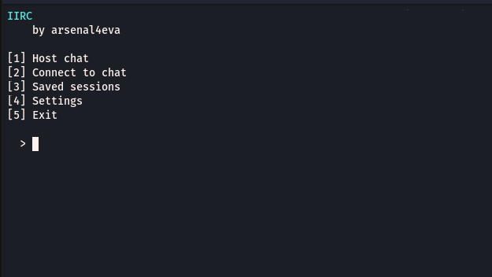

# iirc

a way for two people to chat\
This is largely inspired by Internet Relay Chat (IRC)



## Installation

```sh
curl -fsSL https://raw.githubusercontent.com/arsenal4eva/iirc/main/install.sh | bash
```

or with `wget`:

```sh
wget -qO- https://raw.githubusercontent.com/arsenal4eva/iirc/main/install.sh | bash
```

The app is installed into ~/.iirc

### Requirements

bash 5 is recommended (macOS's default bash might lag)\
netcat (`nc`, `ncat` or `netcat`)\
curl or wget (installer only)\
`ip` on Linux / `ipconfig` on Windows for local IP detection (optional)\

Linux: `sudo apt install netcat-openbsd`\
macOS: `nc` ships with the system\
        To get bash 5, use
```
brew install bash
echo "/usr/local/bin/bash" | sudo tee -a /etc/shells  # Intel
echo "/opt/homebrew/bin/bash" | sudo tee -a /etc/shells # Apple silicon
```
Windows: use Git Bash or MSYS2 and install netcat there\

## Usage

```sh
iirc                       # interactive menu
iirc --host 4444           # host on port 4444
iirc --connect 1.2.3.4     # connect on the default port
iirc --connect 1.2.3.4:4444
iirc --list                # saved sessions
iirc --help
```

The host shares its `ip:port` with the other person, who runs
`iirc --connect <ip>:<port>` (or uses the menu).

### Chat commands

 `/quit` to leave the chat 
 `/nick <name>` to change your username  
 `/clear` to clear the screen 
 `/help` to show help in chat
 There is a bonus command you can find by reading the code :D

Ctrl-C, Ctrl-D and `/quit` all leave the chat and clears screen and returns control to terminal

## How this works

Made completely using Bash, uses nc for connections and runs completely in terminal.

## Current limitations

Might not work on networks with AP isolation, currently only tested for Linux, Windows and MacOS.\
Working towards having more than 2 people to chat on the same port.\


## Disclaimer
Messages are not encrypted for the current version, for privacy please do not use this for sensitive information.


## AI Usage Notice

Opencode with Deepseek V4 Flash Free was used to create debug scripts for simulating execution.
